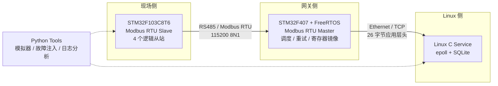

# Industrial Edge Gateway

**STM32F103 Modbus RTU Slave → RS485 → STM32F407 FreeRTOS Gateway → Ethernet → Linux C Service (epoll + SQLite)**


一个面向工业边缘场景的完整通信链路示例：现场设备通过 Modbus RTU 接入 STM32 网关，网关完成多从站轮询、超时重试、离线降频和寄存器镜像，再通过以太网把数据送到 Linux C 服务，最终由 epoll 事件循环解析并写入 SQLite。

> 当前状态：设计定稿，固件与 Linux 服务待实现。仓库中的指标均为设计目标，实测结果会在对应里程碑完成后补充；未完成的功能不会写成已实现。

## 目录

- [系统架构](#系统架构)
- [这个项目展示什么](#这个项目展示什么)
- [关键设计](#关键设计)
- [硬件组成](#硬件组成)
- [仓库结构](#仓库结构)
- [路线图](#路线图)
- [设计文档](#设计文档)
- [测试与数据](#测试与数据)
- [License](#license)

## 系统架构



### 数据流

1. F103 作为 Modbus RTU 从站，模拟 4 个逻辑设备：温度/压力、电量、执行器、预留测试。
2. F407 作为主站，按周期轮询；超时重试、连续失败离线降频、恢复后自动上线。
3. 采集结果写入寄存器镜像，由 NetworkTask 通过 TCP 上报。
4. Linux C 服务用 epoll 管理连接，处理半包/粘包，批量写入 SQLite。

## 这个项目展示什么

- **裸机 Modbus RTU 从站**：0x03/0x04/0x06/0x10、CRC16、异常响应、4 个逻辑从站、故障注入。
- **RS485 时序**：手动 DE/RE 控制，DMA 发送完成后等待 UART TC 再释放总线。
- **FreeRTOS 网关**：非阻塞事务状态机、多从站调度、超时重试、离线降频、恢复上线、寄存器镜像。
- **Linux C 服务**：epoll、非阻塞 socket、半包/粘包处理、心跳、SQLite 批量持久化。
- **可测试性**：Python 从站模拟器、故障注入、日志分析，以及 24 小时稳定性测试计划。

## 关键设计

- **4 个逻辑从站**：3 个业务从站 + 1 个预留/测试从站，单块 F103 模拟。
- **0x03 / 0x04 分离**：测量值走输入寄存器（0x04），参数/控制走保持寄存器（0x03），地址一律 0-based。
- **115200 8N1**：115200 下 3.5 字符间隔只有约 0.3ms，从站必须用 UART IDLE/DMA 判帧。
- **非阻塞事务状态机**：禁止 `send_request(); HAL_Delay(100); wait_response();`，一次只允许一个事务占用 RS485。
- **DE/RE 时序**：DMA 发送完成不等于最后一个字节发完，必须等 UART TC 再释放总线。
- **故障隔离**：超时/CRC 错误后把重试放回队列尾部，先服务其他设备；连续失败 3 次离线，连续成功 2 次恢复。
- **应用层协议**：26 字节固定头，含 payload 长度、payload CRC、header CRC、单调 uptime 时间戳和预留字段。
- **存储策略**：SQLite 按逻辑点位存储，变化触发 + 每点最小 1 秒间隔 + 保留期，避免 24 小时测试写爆磁盘。

详细设计见 [docs/](docs/)。

## 硬件组成

| 硬件 | 说明 |
|---|---|
| STM32F407 探索者 V3 | FreeRTOS 网关；板载 YT8512C 以太网 PHY、SP3485 RS485 |
| STM32F103C8T6 | Modbus RTU 从站，4 个逻辑 Slave ID |
| 3.3V MAX3485/SP3485 模块 | F103 侧 RS485 收发器，DE/RE 由 GPIO 控制 |
| USB-RS485 | PC 调试 / 主站模拟 |
| 120Ω 终端电阻 | 总线两端各一个 |
| USB-TTL | 调试串口 / 故障注入清除 |

## 仓库结构

```text
industrial-edge-gateway/
├── docs/
│   ├── project-framework.md    # 系统组成、模块职责、数据流
│   ├── development-framework.md# 开发流程、任务卡、质量门禁
│   ├── architecture.md         # 系统架构与任务模型
│   ├── protocol.md             # Modbus RTU 与应用层协议
│   ├── register-map.md         # 4 个从站寄存器表与镜像映射
│   └── test-plan.md            # 测试矩阵与稳定性计划
├── gateway-f407/            # FreeRTOS 网关固件（计划中）
├── device-f103/             # Modbus RTU 从站固件（计划中）
├── linux-server/            # Linux C epoll 服务（计划中）
└── tools/                   # Python 模拟器、故障注入、日志分析（计划中）
```

## 路线图

| 阶段 | 目标 | 状态 |
|---|---|---|
| W1 | F103 从站 0x03/0x04/0x06/0x10 + CRC16 + RS485 + 故障注入 | 设计完成，待实现 |
| W2 | F407 主站 + 超时/重试 | 待开始 |
| W3 | FreeRTOS 非阻塞状态机 + 队列 | 待开始 |
| W4 | 4 从站调度 + 寄存器镜像 + 离线/恢复 | 待开始 |
| W5 | Linux C epoll + SQLite + 网关模拟器 | 待开始 |
| W6 | LwIP + 联调 + 24h 稳定性 + 测试报告 | 待开始 |

> 第 4 周结束形成可演示的 MCU MVP；Linux/LwIP 作为加分项。未实测的数字不会写进文档。

## 设计文档

- [项目总体框架](docs/project-framework.md)：系统组成、模块职责、数据流、里程碑
- [开发框架](docs/development-framework.md)：任务卡、分支、测试与质量门禁
- [系统架构](docs/architecture.md)
- [协议说明](docs/protocol.md)
- [寄存器表](docs/register-map.md)
- [测试计划](docs/test-plan.md)

## 测试与数据

测试覆盖正常读写、CRC 错误、非法地址/功能码、超时重试、离线降频、恢复上线、TCP 半包/粘包、断线重连和 24 小时稳定性。所有结果以实测为准，测试完成后补充成功率、P50/P95 延迟、栈余量、队列占用和数据库行数/大小。

## License

[MIT](LICENSE)
