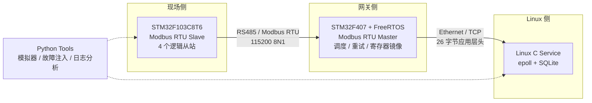
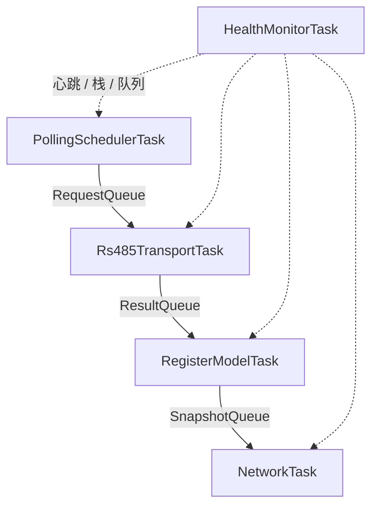
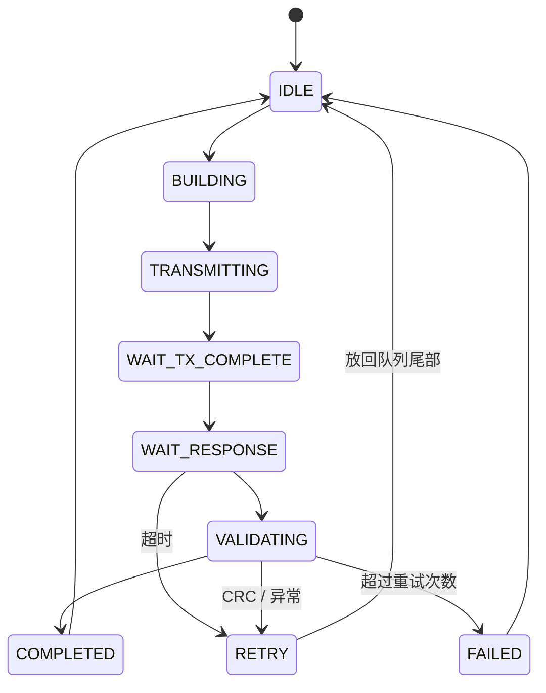

# 系统架构

## 1. 目标

构建一条可复现的工业边缘通信链路，覆盖从现场总线到 Linux 服务的完整路径，并能在故障注入下保持可观测、可恢复。

核心问题：

- Modbus RTU 从站如何稳定响应，并正确处理帧边界、CRC、异常码和 DE/RE 时序。
- 网关如何在不阻塞其他任务的前提下完成多从站轮询、超时重试、离线降频和恢复。
- Linux 服务如何处理 TCP 字节流、半包/粘包，并把数据可靠地写入 SQLite。

## 2. 范围

### 2.1 本阶段实现

- F103 裸机 Modbus RTU 从站（4 个逻辑 Slave ID）
- F407 FreeRTOS Modbus RTU 主站/网关
- Linux C epoll + SQLite 服务
- Python 模拟器、故障注入、日志分析
- 24 小时稳定性测试

### 2.2 非目标

- GUI、云平台、多网关集群
- AUTOSAR、DoIP、车载以太网
- 生产级安全认证、TLS、远程升级
- 追求一次性做完所有功能

## 3. 系统上下文



数据流：

1. F103 模拟 4 个逻辑从站，维护各自的寄存器空间。
2. F407 按调度周期发起 Modbus 事务，拿到结果后更新寄存器镜像。
3. NetworkTask 将镜像中的点位批量封装为应用层消息，通过 TCP 上报。
4. Linux 服务解析消息，按策略批量写入 SQLite。

## 4. F103 从站

### 4.1 角色

| Slave ID | 角色 | 主要寄存器 |
|---|---|---|
| 1 | 温度/压力传感器 | 状态、温度、压力、报警；采样周期 |
| 2 | 电量采集 | 电压、电流、累计电量；清零命令 |
| 3 | 执行器 | 输出状态；输出控制、目标值 |
| 4 | 预留/测试 | 运行计数；测试写入值 |

每个从站都有 `0x00F0` 故障注入寄存器。

### 4.2 关键约束

- 裸机运行，无动态内存，固定 256 字节收发缓冲区。
- 115200 8N1；3.5 字符间隔约 0.3ms，必须用 UART IDLE/DMA 判帧。
- 发送前拉高 DE；DMA 完成后继续等待 UART TC，再拉低 DE 回接收。
- 校验从站地址、功能码、帧长度、寄存器空间、寄存器范围、CRC16。
- 支持广播写（地址 0），只执行写，不响应。
- 异常响应格式为：功能码 | 0x80，后跟 1 字节异常码。
- 主循环用 SysTick 做非阻塞节拍；`HAL_Delay()` 只允许在初始化阶段使用。

### 4.3 故障注入

```c
typedef enum {
    FAULT_NONE = 0,
    FAULT_NO_RESPONSE,
    FAULT_BAD_CRC,
    FAULT_DELAY_RESPONSE,
    FAULT_EXCEPTION_CODE,
    FAULT_TRUNCATED_FRAME
} FaultMode;
```

- 每个逻辑从站的 `0x00F0` 都可写该枚举，只影响当前从站。
- `FAULT_NO_RESPONSE` 生效后无法通过 Modbus 清除，因此 30 秒后自动恢复 `FAULT_NONE`。
- `FAULT_DELAY_RESPONSE` 默认延迟 500ms，用于主站超时测试。
- 调试串口可以立即清除故障注入。

## 5. F407 网关

### 5.1 任务划分

| 任务 | 优先级 | 职责 |
|---|---|---|
| Rs485TransportTask | 高 | 独占 UART/RS485，执行事务 |
| PollingSchedulerTask | 中高 | 生成周期读取/写请求 |
| RegisterModelTask | 中 | 更新缓存、有效期、状态 |
| NetworkTask | 中 | TCP 连接与数据上报 |
| HealthMonitorTask | 低 | 任务心跳、栈余量、喂狗 |

约束：

- 禁止多个任务直接访问 UART。
- 只有所有关键任务健康时才喂狗。
- 记录 `uxTaskGetStackHighWaterMark()` 与 `uxQueueMessagesWaiting()`。
- 初始队列深度建议：RequestQueue 16、ResultQueue 16、SnapshotQueue 8；根据实测占用调整。

### 5.2 队列与数据流



### 5.3 事务状态机



关键点：

- 一次只允许一个事务占用 RS485。
- DMA 完成只代表数据搬到 UART，最后一个停止位还没发完；必须等 UART TC。
- 超时/CRC 错误后不原地阻塞重试，把请求放回队列尾部，先服务其他到期设备。
- `retry_max = 2` 表示首次失败后最多再重试 2 次。

### 5.4 调度策略

- 正常设备按各自周期轮询。
- 写请求优先于普通采集。
- 连续失败 3 次标记离线。
- 离线后轮询间隔从 500ms 拉长到 5s（可按设备配置 2s/5s/10s）。
- 连续成功 2 次恢复在线。
- 单次读取数量默认不超过 20 个寄存器。
- 50ms 超时按 20 寄存器响应约 4ms 留出约 10 倍余量。
- 队列满必须统计并记录；一个故障设备不能阻塞其他设备。

示例：

| 设备 | 周期 | 超时 | 重试 | 失败阈值 | 离线周期 |
|---|---|---|---|---|---|
| 温度设备（Slave 1） | 500ms | 50ms | 2 | 3 | 5s |
| 电量设备（Slave 2） | 1000ms | 50ms | 2 | 3 | 10s |
| 执行器状态（Slave 3） | 200ms | 50ms | 2 | 3 | 2s |
| 预留从站（Slave 4） | 1000ms | 50ms | 2 | 3 | 5s |

### 5.5 寄存器镜像

镜像按逻辑点建模，不按单个 16 位寄存器建模；32 位值一次性更新，避免半新半旧。

```c
typedef struct {
    uint32_t value;           // 16 位点符号/零扩展后统一存 uint32
    uint8_t  size;            // 1 = 16 位，2 = 32 位
    uint8_t  space;           // 0 = 保持寄存器，1 = 输入寄存器
    uint16_t source_address;  // 从站起始地址
    uint32_t timestamp_ms;
    uint32_t valid_duration_ms;
    bool valid;
    bool writable;
} RegisterEntry;
```

地址分区：

| 分区 | 地址范围 | 说明 |
|---|---|---|
| 从站状态 | 0x0000–0x003F | 每从站 0x10 |
| 保留 | 0x0040–0x00FF | — |
| 测量值 | 0x0100–0x01FF | 每从站 0x40 |
| 控制/参数 | 0x0200–0x02FF | 每从站 0x40 |
| 通信统计 | 0x0300–0x03FF | 每从站 0x40 |
| 系统健康 | 0x0400–0x04FF | 全局 |

映射公式：`分区基址 + (slave_id - 1) * 0x40 + 点内偏移`。点内偏移是 register-map 中分配的紧凑索引，不是从站本地寄存器地址。

### 5.6 健康监控

- 每个关键任务维护心跳计数。
- HealthMonitorTask 只有在所有心跳都在有效期内时才喂狗。
- 记录栈 high water mark 和队列占用，作为后续收紧资源的依据。
- 任何任务卡死都应触发看门狗复位，而不是静默挂起。

## 6. Linux 服务

### 6.1 线程模型

```text
Main Thread
├── epoll 事件循环
├── accepter
├── socket read/write
└── 心跳检查

Database Thread
└── SQLite 批量写入

Logger Thread
└── 异步日志
```

### 6.2 epoll 与拆包

- 非阻塞 socket，EPOLLIN/EPOLLOUT。
- 每个连接独立接收缓存。
- 先读 26 字节固定头，校验 magic、version、长度和 header CRC。
- 再按 `payload_length` 读取 payload，校验 payload CRC。
- 处理 EINTR/EAGAIN、对端关闭、发送缓冲区未全部发送。
- 不能假设一次 `recv()` 就能拿到完整一帧。

### 6.3 SQLite

表：

- `gateway`：网关首次/最后在线时间、固件版本。
- `device`：从站在线状态、最后在线时间、离线次数。
- `device_data`：按逻辑点位存储，含 `point_id`、`register_space`、原始值、缩放、质量和时间戳。
- `fault_event`：故障事件。

写入策略：

- 变化触发 + 每个点位最小 1 秒间隔。
- 每 500ms–1s 批量提交。
- 开启 WAL。
- 默认保留 7 天，按天清理。
- 存原始 uint32 + scale，不用 REAL 存所有值。

## 7. 故障处理与可观测性

| 场景 | 处理 |
|---|---|
| Modbus 超时 | 重试，放回队列尾部；连续失败 3 次离线 |
| CRC 错误 | 丢弃帧并计数；按超时策略重试 |
| 从站离线 | 降频轮询；连续成功 2 次恢复 |
| 队列满 | 计数并记录；不阻塞生产者 |
| TCP 半包/粘包 | 每连接缓存；按固定头长度拆包 |
| 心跳超时 | 标记连接断开，清理会话 |
| SQLite 写入失败 | 记录错误并重试；不阻塞网络线程 |
| 看门狗 | 所有关键任务健康才喂狗 |

可观测数据：

- Modbus 成功率、重试次数、离线次数、恢复次数。
- 事务延迟 P50/P95。
- 栈 high water mark、队列占用峰值。
- TCP 连接数、拆包错误数、心跳超时数。
- SQLite 行数、数据库大小、WAL 大小。

## 8. 关键约束与取舍

- 115200 而不是 9600：4 从站、200ms 最短周期下，9600 的事务时间会挤满周期。
- 单事务串行：RS485 是半双工总线，同一时刻只能有一个事务。
- 固定缓冲区、无动态内存：避免堆碎片和不可预测的延迟。
- 逻辑点存储：避免 32 位值跨两个寄存器出现半新半旧。
- 变化触发 + 1s 下限：24 小时测试的数据量可控。
- 先 MCU MVP，再 Linux/LwIP：第 4 周形成可演示的最小闭环。

## 9. 当前状态

设计定稿，W1 待实现。后续每完成一个阶段，在 README 路线图和 `docs/test-plan.md` 中更新状态与实测结果。
